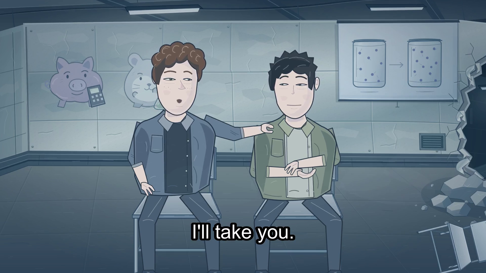

# The Lesson



**A 24-second adaptation of the classroom incident in *Snowmoon*, Chapter 2, by Vitalik Buterin. English captions and recorded CC0 effects; no spoken voices.**

[Watch/download the film](The-Lesson-CC0-SFX-English-captions-1080p120.mp4) · [Video player](index.html) · [Download the editable production package](The-Lesson-v8-source-GPL3.zip)

Adaptation production: **ProMartY, with OpenAI Codex assistance**. Original novel: [Vitalik Buterin — Snowmoon](https://vitalik.eth.limo/snowmoon/), [Chapter 2](https://vitalik.eth.limo/snowmoon/html/chapter-2.html).

The film is 24 seconds, 1920×1080 at 120 fps. Original editable SVG contours, authored pose curves and vector deformations are sampled at each timestamp. This is code-assisted vector animation, rather than a traditionally hand-drawn film. No neural-generated picture/video or optical-flow frame interpolation is used in this cut.

## Editable source and reproduction

Download and extract `The-Lesson-v8-source-GPL3.zip`. It contains the original SVG sets/props, character and acting code, English script/subtitles, mouth-timing data, recorded CC0 effects/used source clips, source hashes/license notices, and a portable Node.js/FFmpeg pipeline. Its README contains the full instructions. No executable, model, credential or generated speech recording is bundled.

With Node.js 22+, Sharp and FFmpeg installed, from the extracted folder:

```sh
npm install
npm run render
node assemble-captions.cjs
```

The original caption family was Arial 23 pt, outline 2, vertical margin 32. No proprietary font file is bundled; the reproduction instructions allow another installed font. Rendering and caption assembly use local tools with no subscription or paid generation service.

## Credits and license

Original adaptation art, code, script/timing and production materials: **GPL-3.0-only**; [complete GPL v3 text](LICENSE.txt). The official novel also identifies GPL v3 and asks adaptations to open their task-specific production pipeline. Full attribution and production notes are included inside the source archive.

Recorded effects retain their **CC0-1.0** status: [Kenney — Impact Sounds](https://kenney.nl/assets/impact-sounds), [Kenney — Interface Sounds](https://kenney.nl/assets/interface-sounds), [rubberduck — 100 CC0 SFX #2](https://opengameart.org/content/100-cc0-sfx-2), and [LEGIT Audio — The Shop free OpenGameArt samples](https://opengameart.org/content/the-shop). Original source notices, exact used clips and hashes are in the archive.

Codex assisted adaptation, vector/code drawing, acting curves, corrections, rendering and packaging. A generated-voice reference was used for historical timing; its recordings are excluded from the public release because redistribution rights were not established. The disabled-by-default reference harnesses are included for process transparency. The public soundtrack contains CC0 effects only.

No endorsement by the original author, tool providers or bounty organizer is implied.
